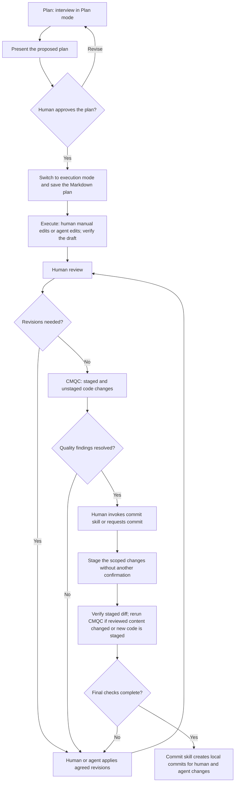

# Standard Operating Procedure: Plan to Commit

Use this procedure for human and AI-assisted work on the GoPick Assessment Center Manual. The flow is **Plan → Execute → Human Review and Revisions → Code Maintenance and Quality Checks → Commit**.

Humans may edit files manually in their editor during implementation, revisions, and quality fixes. An agent may also make the edits, or both may contribute. The same review and verification requirements apply regardless of who writes the changes. Use the commit skill to commit the resulting human-authored, AI-authored, or mixed changes locally.

Follow [AGENTS.md](AGENTS.md) and [CONTRIBUTING.md](CONTRIBUTING.md) for repository ownership, verification, branches, and releases. Human decisions define the scope. Approval to implement a plan is separate from authorization to commit.

## Workflow

## Stage responsibilities and completion criteria

| Stage | Responsible participants | Required work | Output and condition to advance |
|---|---|---|---|
| **1. Plan** | Human and implementing agent | Inspect the relevant repository files. Interview the human in Plan mode to resolve intent, scope, constraints, and acceptance criteria. Present a concrete plan for review. | Human-approved plan, saved as a Markdown file once execution mode permits writes. |
| **2. Execute — Create Draft** | Human editing manually, agent, or both | Implement the approved plan on the appropriate contribution branch. Preserve content ownership and navigation contracts. Synchronize Markdown and rendered content where applicable. Perform required verification and prepare a reviewable diff or preview. | Draft implementation, verification evidence, and a concise explanation of what changed. |
| **3. Human Review and Revisions** | Human reviewer and human or agent implementer | Review the draft against the plan. Capture feedback, apply agreed revisions manually or through the agent, and repeat review. Return to planning if feedback changes the approved scope or architecture. | Human acceptance of the revised draft, with feedback addressed. Acceptance alone does not authorize a commit. |
| **4. Code Maintenance and Quality Checks** | Implementer using CMQC | Run [CMQC](.agents/skills/cmqc/SKILL.md) on staged and unstaged HTML, CSS, and JavaScript changes. Report findings with file locations, size classifications, and actions. Obtain authorization for repairs not already covered by the plan; return repairs to human review and rerun checks. | Findings resolved and applicable verification complete. Disclose exclusions and incomplete checks; do not claim a pass for unreviewed code. |
| **5. Commit** | Human invokes; agent runs the commit skill | Follow [gopick-commit](.agents/skills/gopick-commit/SKILL.md) for human-authored, AI-authored, or mixed changes. Invocation authorizes local commits and related changelog edits. Select focused groups and messages, automatically update the PR's changelog entries, stage the scoped changes, inspect the diff, and complete required checks without another confirmation. | Local commit hash, final message, and remaining working-tree status. No push or merge through the skill. |

## Markdown plan

Use the existing task plan when it belongs to the same work. For separate work, create a task-specific Markdown plan in the agreed location; do not overwrite an unrelated plan. The existing root [plan.md](plan.md) describes the UI uniformity and image-placeholder work and is not a blank template.

During Plan mode, interview the human and present the proposed plan without editing repository files. After plan approval and a switch to execution mode, save the approved plan before implementation. If the tool permits plan artifacts during planning, follow its mode restrictions and retain the approved Markdown artifact.

The plan must contain:

- Objective, intended users, and observable acceptance criteria.
- Included work, exclusions, and affected file owners.
- Human decisions, constraints, dependencies, and resolved questions.
- Ordered implementation steps and required verification.
- Review feedback and subsequent approved changes to the plan.

Ask questions about decisions that cannot be established from the repository. Resolve missing context before presenting assumptions as confirmed behavior.

## Quality checks and commit handoff

After manual editing, save the files before invoking `$cmqc` in Codex or `/cmqc` in Claude and Antigravity. Once review and checks are complete, invoke `$gopick-commit` or `/gopick-commit` respectively. The commit skill inspects the actual Git changes, including manual edits; the agent does not need to recreate them. Reinspect the diff and rerun affected checks if either the human or agent edits files after verification.

CMQC checks complete changed files and distinguishes staged contents from unstaged contents. It excludes unchanged and untracked files. When new HTML, CSS, or JavaScript files are staged after commit authorization, rerun CMQC so they are checked before the commit. An empty CMQC scope means there were no eligible code files, not that other work was verified.

| CMQC check | Required interpretation |
|---|---|
| More than 800 physical lines | Critical: stop extending the file and decompose it by responsibility. |
| 501–800 physical lines | Warning: actively refactor within the authorized maintenance scope. |
| 201–500 physical lines | Sweet spot: no line-count action required. |
| 200 physical lines or fewer | No size warning; do not enlarge files to meet a target. |
| File named exactly `dataFiller.js` | Exempt from line-count limits only. |
| Embedded or inline CSS/JavaScript | Prohibited markup must move to the owning external files; preserve dependencies and load order. |

The [CMQC skill](.agents/skills/cmqc/SKILL.md) defines the detailed checks and exceptions. CMQC does not replace the repository's required browser, accessibility, syntax, asset-reference, or Markdown-parity verification. Report pre-existing violations separately from regressions; do not silently expand the implementation scope to repair them.

Before committing, ensure the following:

- The user has invoked the commit skill or requested a commit. Invocation is authorization; do not present proposals or ask for another confirmation. Honor explicit scope restrictions and message-only, review-only, or dry-run requests.
- The contribution branch follows the repository rules and is not `main`.
- The staged diff contains only the intended changes, including the relevant changelog entry. Preserve unrelated work and staging.
- New staged code and any content changed after review have completed the applicable quality checks and human review.
- The message uses `<label>(<optional-scope>): <imperative summary>`. Use `docs` if any Markdown is included, `feat` for a new non-Markdown capability, and `fix` for other non-Markdown changes.
- The PR retains one dated changelog version; another commit does not create another version. Follow the existing release guide for version selection and verified identifiers.

The procedure ends with a local commit. The commit skill never pushes or merges. Any later PR targeting `main` remains subject to the repository's separate peer-approval and resolved-review requirements.
